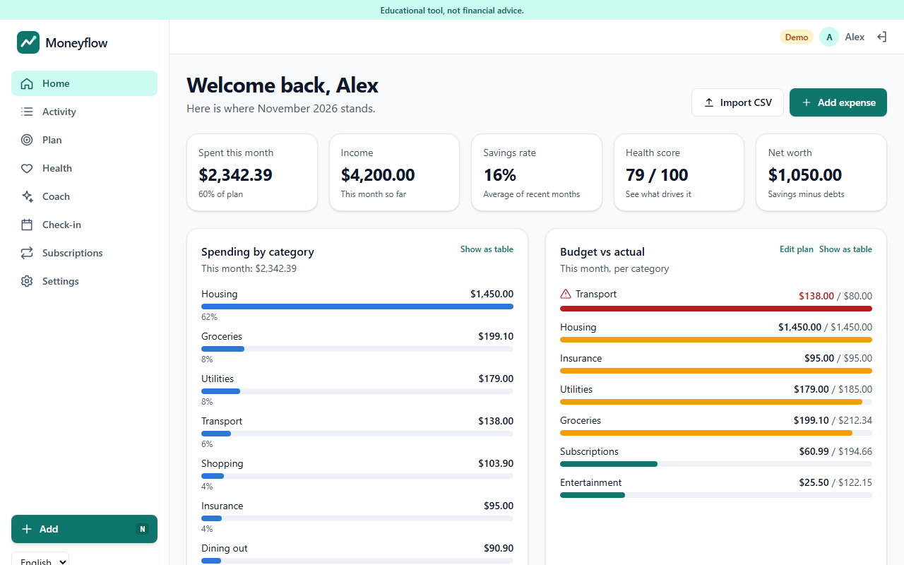
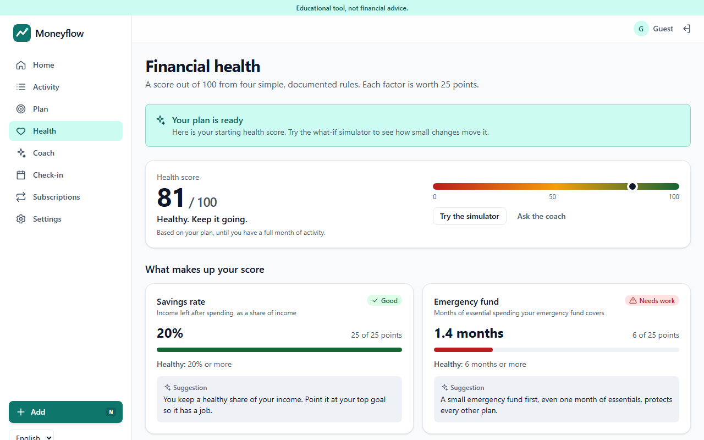
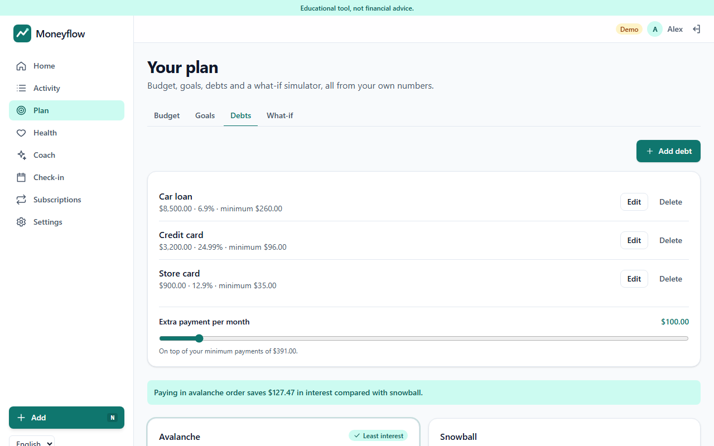
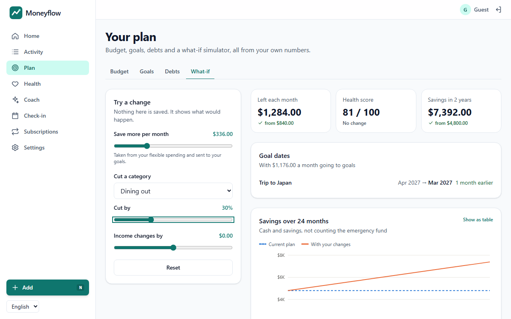
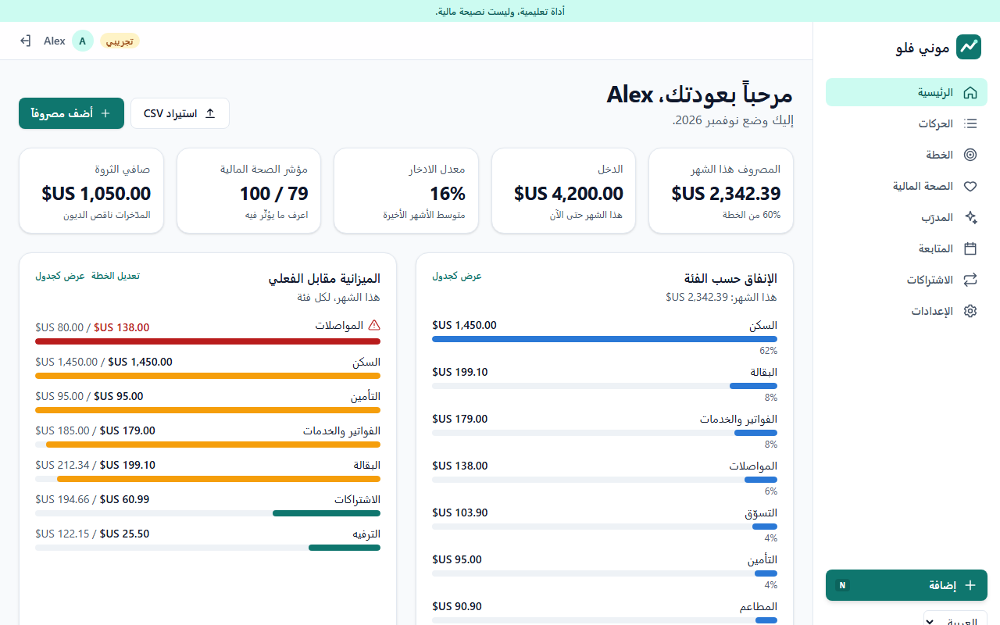
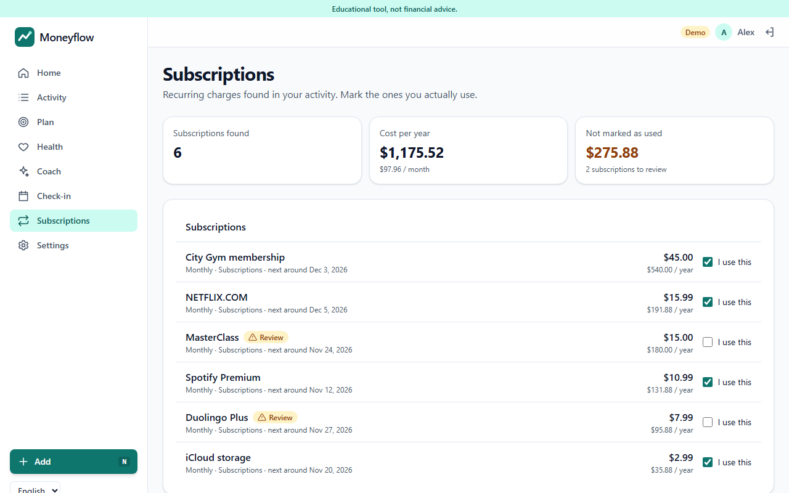
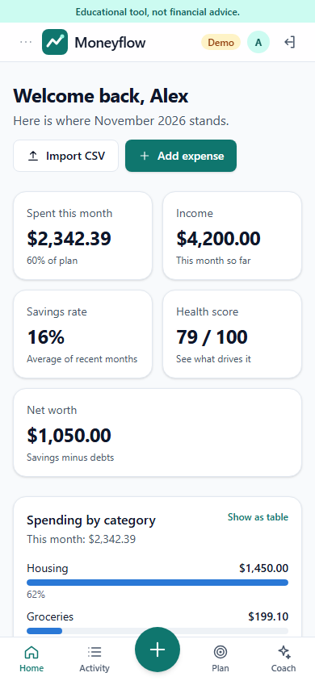
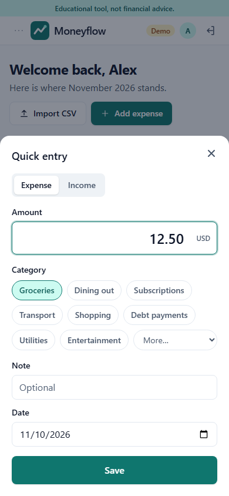
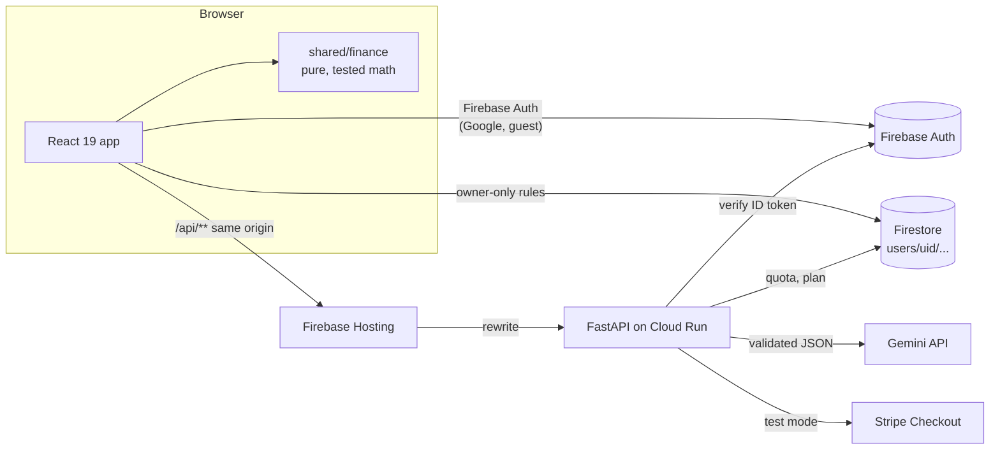

# Moneyflow

**A personal money coach.** Understand your money, plan for goals and build
better habits, with an AI coach that explains, plans and checks in every month.

**Live demo:** [moneyflow-coach.web.app](https://moneyflow-coach.web.app). Press
**Try the demo** for a private sample account with four months of data. No
sign-up needed.

> Educational tool, not financial advice.


## Why it is more than an AI chat

- **It keeps your numbers.** Incomes, fixed costs, debts, accounts, goals and every transaction live in your own Firestore space.
- **It tracks real spending against a plan.** You get a 50/30/20, zero-based or custom budget, with plan vs actual per category.
- **It simulates with real math.** Goal timelines, avalanche vs snowball payoff and what-if scenarios all come from a tested, pure TypeScript module.
- **It follows up.** A monthly check-in summarizes the month and proposes budget changes you accept or dismiss.
- **The AI never computes a number.** It receives numbers the code already computed and returns validated JSON or text.

## Features

| Area         | What you can do                                                                                                                                                   |
| ------------ | ----------------------------------------------------------------------------------------------------------------------------------------------------------------- |
| Onboarding   | Seven-step wizard with one question per screen, progress bar, Back that keeps answers, inline validation, skip on optional steps, and a review screen             |
| Health check | Score out of 100 from four documented rules, each factor with its value, healthy threshold and an AI-written tip, plus month-by-month history                     |
| Plan         | Editable budget, goal timelines chart, debt payoff comparison, and a what-if simulator with instant charts                                                        |
| Daily use    | Five-second quick entry (press N), recurring items, CSV import with column mapping, duplicate detection and AI category suggestions, subscription tracker         |
| Coach        | Chat that answers "Can I afford a 900 phone in March?" by calling the simulator, and politely refuses investment, tax, legal and credit advice                    |
| Insights     | Dashboard with spending by category, monthly trend, budget vs actual, savings rate and net worth; CSV export and a printable monthly PDF                          |
| SaaS shell   | Google sign-in, guest and demo modes, Free and Pro plans with Stripe Checkout in test mode, daily AI quotas, settings, account deletion, privacy page             |
| Reach        | English and Arabic with full right-to-left layout, per-locale number formatting, 12 currencies with manual exchange rates, phone-first layout, WCAG 2.1 AA checks |

|                                                       |                                                |
| ----------------------------------------------------- | ---------------------------------------------- |
|                 |          |
|        |  |
|  |  |

<p>
  
  
</p>

## Architecture



| Folder    | Stack                                                                                              | Responsibility                                                                                                                                                                       |
| --------- | -------------------------------------------------------------------------------------------------- | ------------------------------------------------------------------------------------------------------------------------------------------------------------------------------------ |
| `shared/` | TypeScript, Zod                                                                                    | Finance module, Firestore document schemas, API contract types, demo data generator                                                                                                  |
| `web/`    | React 19, TypeScript strict, Vite, Tailwind v4, TanStack Query, Zustand, React Hook Form, Recharts | UI, Firestore reads and writes, running coach tools in the browser                                                                                                                   |
| `api/`    | Python 3.12, FastAPI, Pydantic v2                                                                  | Token verification, rate limits and quotas, Gemini calls with validation, Stripe, account deletion                                                                                   |
| `docs/`   | Markdown                                                                                           | [Architecture](docs/architecture.md), [finance rules](docs/finance-rules.md), [API contract](docs/api-contract.md), [deployment](docs/deploy.md), [decision records](docs/decisions) |

## How calculations and AI are separated

1. Every number comes from `shared/src/finance/`, which has no framework, network or storage code. Money is integer minor units; currency conversion uses BigInt; splits use the largest-remainder method so parts always add up. Every rule is written down in [docs/finance-rules.md](docs/finance-rules.md).
2. The browser computes totals, scores and projections, and sends the API only those results as structured context.
3. The API asks Gemini for JSON against a response schema, validates it with Pydantic, retries once, and otherwise falls back to deterministic English or Arabic text.
4. When the coach needs a calculation, Gemini returns a function call such as `check_affordability`. The browser runs it with the finance module and sends back the results with amounts already formatted, and Gemini only explains them. The chat shows each result as a card labelled "Computed by the finance module, not by the AI".
5. Guardrails sit on both sides of the model. A deterministic pre-filter catches requests for investment, tax, legal or product advice, and the system prompt repeats the rule. A post-filter replaces any reply that recommends products, tickers or crypto.

## Quality

| Suite                            | What it covers                                                                                                                                                     | Count |
| -------------------------------- | ------------------------------------------------------------------------------------------------------------------------------------------------------------------ | ----- |
| `shared` (Vitest)                | Budgets, health score, goals, debt payoff with hand-computed schedules, simulator, affordability, recurring detection, CSV parsing, duplicate detection, demo data | 107   |
| `web` (Vitest + Testing Library) | Finance view, onboarding writes, import review, coach tools, check-in, exports, number input, translation key coverage in both languages                           | 50    |
| `api` (pytest)                   | Auth, validation limits, quotas, guardrails in English and Arabic, Gemini request and response handling, fallbacks, billing, account deletion                      | 444   |
| Firestore rules                  | Cross-user access, unknown collections, float amounts, server-only plan and usage documents                                                                        | 8     |
| Playwright on emulators          | Wizard to health score to simulator, demo dashboard, debts, Arabic right-to-left, quick entry, mobile menu, axe WCAG 2.1 AA scans                                  | 10    |

CI runs lint (ESLint strict type-checked, Ruff), type checks (`tsc` strict, `mypy --strict`), all suites above, both builds and a container smoke test on every push.

## Key decisions

- **Firebase only.** Hosting, Auth and Firestore, with the API on Cloud Run behind a Hosting rewrite: one origin, one bill, scale to zero. See [ADR 0001](docs/decisions/0001-firebase-only-hosting.md).
- **The browser runs coach tools.** The finance module exists once, in TypeScript, and the API stays a thin, validated AI layer.
- **No Cloud Functions.** Recurring transactions are recorded when the app opens, with deterministic ids, so two tabs never create duplicates.
- **Server-only plan and usage.** Security rules let users read `billing/{uid}` and `usage/{uid}` but never write them.
- **Print to PDF for reports.** It keeps Arabic shaping and right-to-left layout exactly as on screen, with no heavy PDF dependency.
- **Stripe test mode is enforced in code.** The API refuses any key that does not start with `sk_test_`.

## Run locally

Requirements: Node 22, pnpm 10, [uv](https://docs.astral.sh/uv/), and Java 21 for the Firebase emulators.

```bash
pnpm install
cp web/.env.example web/.env.local        # Firebase web config (public values)
pnpm dev                                   # web on http://localhost:5173

cd api && uv sync && cp .env.example .env && cd ..
pnpm api:dev                               # API on http://localhost:8080/api/docs
```

Checks:

```bash
pnpm lint && pnpm typecheck && pnpm test   # shared + web
pnpm api:lint && pnpm api:test             # api
pnpm --filter @moneyflow/web build:e2e
firebase emulators:exec --only auth,firestore --project demo-moneyflow "pnpm --filter @moneyflow/web e2e"
```

## Deploy

Pushes to `main` run CI, deploy the web app and Firestore rules to Firebase
Hosting, and deploy the API to Cloud Run when `api/` changes. Two one-time
scripts set up credentials and secrets: `scripts/setup-deployer.sh` and
`scripts/setup-runtime.sh`. Details are in [docs/deploy.md](docs/deploy.md).

## License

MIT
